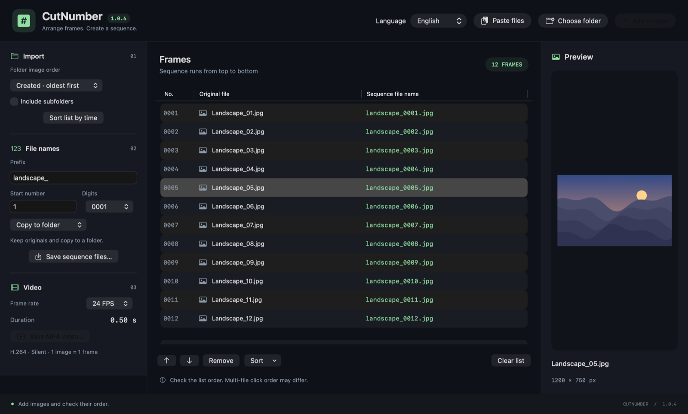

# CutNumber

CutNumber is a desktop app for arranging images, renaming them as a numbered sequence, and exporting the sequence as a silent H.264 MP4.

## Download CutNumber 1.0.4

| Platform | Download | Getting started |
| --- | --- | --- |
| macOS — Apple Silicon, macOS 13 or later | [Download macOS DMG][mac-download] | Open the DMG and drag **CutNumber.app** to **Applications**. Launch it from Applications. |
| Windows — x64, Windows 11 or Windows 10 22H2 | [Download Windows ZIP][windows-download] | Extract the entire ZIP, then open **CutNumber.exe**. To add Start menu and desktop shortcuts, run **Install.cmd**. |

The macOS app is ad hoc signed and has not been notarized by Apple. The Windows ZIP includes the required .NET runtime.



[mac-download]: https://github.com/Choikuidong/CutNumber/releases/download/v1.0.4/CutNumber-1.0.4.dmg
[windows-download]: https://github.com/Choikuidong/CutNumber/releases/download/v1.0.4/CutNumber-Windows-1.0.4.zip

## Use CutNumber

1. Add images or folders using the toolbar, drag and drop, or paste.
2. Arrange the frames. Sort by creation or modification time, move rows, and select a frame to preview it.
3. Save copies with sequential file names, rename the originals, or export the list as an MP4 at the selected frame rate.

English is the default. The language selector supports Korean, Japanese, Simplified Chinese, Spanish, French, German, Portuguese, Russian, and Arabic. Changes apply immediately and are saved for the next launch. Native file dialog controls and system error details can follow the operating system language.

## Build from source

On an Apple Silicon Mac with Xcode Command Line Tools:

```sh
./src/macOS/build.command
```

The built application is placed in the macOS subfolder of `build`.

To build the self-contained Windows x64 application with the .NET 10 SDK:

```sh
dotnet publish src/Windows/CutNumber.csproj -c Release -r win-x64 --self-contained true -o build/Windows
```

Windows 11 x64 and Windows 10 22H2 x64 are the intended targets. HEIC and WebP support can depend on installed codecs. Windows N may require the Media Feature Pack for video export. The Windows build was cross-compiled and its file operations were tested. The Windows interface, installation, and video export have not been exercised on Windows.

## Checks

```sh
python3 tests/check-translations.py
./tests/check-macos-about.command
dotnet run --project tests/LocalizationTests.csproj
```

Developed by Kuidong Choi at [Apple Craft](https://applecraft.kr).

© 2026 Apple Craft. All rights reserved.
